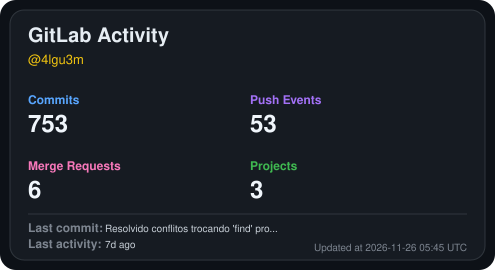

# 👨🏻‍💻 Marcelo Líryo

**`Pesquisador de Robótica & Visão Computacional | Desenvolvedor de Software`**

Olá! Sou graduando em Sistemas de Informação na UNEB (Salvador, BA) e pesquisador voluntário no ACSO/UNEB, integrando a equipe BahiaRT (Bahia Robotics Team) na liga de robótica de serviço @Home. Desenvolvo o ecossistema de software do robô BILL, com foco em visão computacional, ROS 2 e sistemas embarcados.

Fora do código, tenho mais de 11 anos de Movimento Escoteiro (insígnias máximas de todos os ramos até o Ramo Pioneiro), o que moldou minha forma de liderar, comunicar e trabalhar em equipe.

---

### 🔬 Pesquisa e Robótica

- 🤖 **BahiaRT / ACSO (UNEB)** — pesquisador voluntário desde julho de 2025, trabalhando no robô de serviço **BILL**.
- 👁️ **Visão computacional:** pipeline de reconhecimento de objetos com **YOLOv8 + OpenCV + PyTesseract (OCR)** e estimativa de pose.
- 🔌 **Embarcados:** drivers ROS 2 e integração de sensores a laser, câmeras e microcontroladores **Arduino Nano**.
- 🗂️ **Datasets:** métodos de avaliação e construção de datasets para treinar modelos YOLOv8 em robótica de serviço.

### 📄 Produção científica

- **LARA: Language-to-Action Robotic Architecture for Command Interpretation in Service Robotics** — coautor, aceito no **XVIII Simpósio Brasileiro de Robótica (SBR 2026)**.
- **Métodos de Criação de Datasets para Detecção de Objetos** — apresentado na **VI JAPEX/UNEB** (setembro de 2026), com Felipe Tinel e Lucas Oliveira Caldas.
- Representei a BahiaRT e o ACSO/UNEB no **Mundo Senai 2026** e participei de eventos como **RoboCup** e **Robodori**.

---

### 🤖 Linguagens e Tecnologias

---

### 🚀 Projetos

- 🤖 **BILL (BahiaRT@Home)** — visão computacional, OCR e estimativa de pose, além de componentes front-end da aplicação web da equipe.
<!-- - 🌐 **Farofa Vovó Dinah** — site institucional com mapa interativo de lojas (projeto de portfólio freelance). -->
<!-- - 🎵 **Automação com Spotify + Last.fm** — scripts em Python (`spotipy`) para organizar playlists por artista e filtrar faixas por subgênero. -->
<!-- - 🎮 **MinecraftServerSI** — servidor PaperMC para colegas da universidade (LuckPerms, BlueMap, DeluxeMenus, Skript). -->
- 🕹️ **Godot 4** — protótipos de mecânicas 2D/isométricas.

### 🎓 Formação e Certificações

- 🎓 **Bacharelado em Sistemas de Informação** — UNEB (2025 – 2030)
- 🇬🇧 **Linguaskill (Cambridge English) — B2**, com C1 em Leitura e Compreensão Auditiva
- 🐍 **Linguagem de Programação Python – Básico** — Fundação Bradesco
- 💻 **Learn the Command Line** & outras certificações da **Codecademy** que ainda estão por vir.

### 🎨 Outras habilidades

Suporte de TI (manutenção de PCs e notebooks, instalação de sistemas) e edição audiovisual (**Photoshop, Premiere Pro, Audacity**).

---

### 📊 Estatísticas

